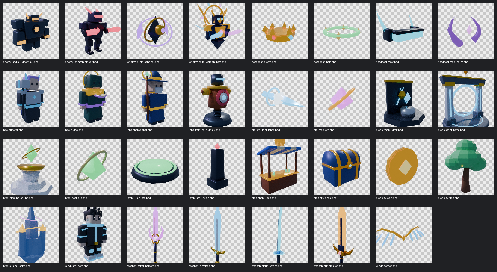
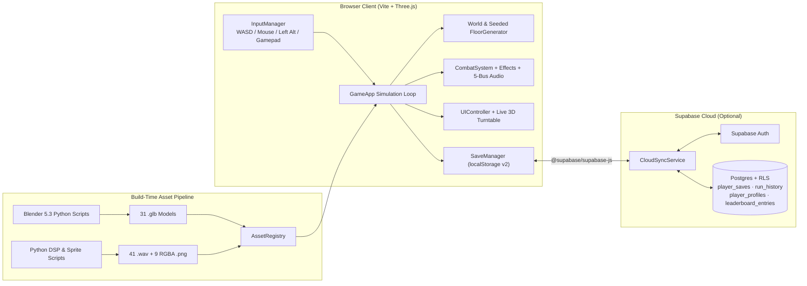

<div align="center">

# Cloudspire Ascent

**A locally playable 3D sky-tower action-platformer with 31 Blender-sculpted `.glb` assets, real-time sword ribbon VFX, 5-bus `.wav` audio, Roblox-style Left Alt Shift Lock, and optional Supabase cloud saves & global leaderboards.**

[](https://www.typescriptlang.org/)
[](https://threejs.org/)
[](https://vitejs.dev/)
[](https://www.blender.org/)
[](https://supabase.com/)
[](https://vitest.dev/)

<br />



<br />

[Quick Start](#quick-start) · [Core Features](#core-features) · [Architecture](#tech-stack--architecture) · [Controls](#controls) · [Roadmap](#roadmap--contributing)

</div>

---

## Core Features

- **⚔️ 31 Authored Blender 5.3 `.glb` Models**: Articulated `vanguard_hero.glb` with swappable headgear/wings, 4 melee weapons (*Aether Skyblade*, *Tempest Katana*, *Solar Claymore*, *Starfall Glaive*), 3 Sanctuary Hub NPCs, 4 Construct enemies & Summit Boss, and 11 interactive world props.
- **✨ Combat VFX & 5-Bus `.wav` Audio**: Real-time 3D weapon ribbon trails (`BladeBase` -> `BladeTip`), directional star-sparks, crescent slashes, floating damage numbers, and 41 synthesized 44.1kHz `.wav` cues routed across Master, Music (with combat ducking), Combat SFX, Sky Wind Ambience, and UI buses.
- **🎮 Responsive Controls & Left Alt Shift Lock**: PC-first third-person movement with coyote/double jump, 3-hit melee combo, active skills, Gamepad support, and **`Left Alt`** Free Mouse toggle to unlock your cursor on the fly without pausing.
- **🖥️ Live 3D WebGL Turntable & Screen-Stack UI**: Offscreen-rendered 3D weapon, skin, and NPC bust portraits, interactive drag-to-rotate 3D loadout showcase, Combo Hit-Streak HUD, and keyboard/gamepad focus-trapped modals.
- **☁️ Local-First + Supabase Cloud Sync**: Instant browser `localStorage` persistence (`cloudspire_ascent_save_v2`) paired with optional **Supabase** Auth, RLS-protected cloud saves (`player_saves`), `run_history`, and a live **Global Cloud Leaderboard**.

---

## Tech Stack & Architecture

| Layer | Technology | Purpose |
| :--- | :--- | :--- |
| **Frontend & 3D Engine** | TypeScript, Vite, Three.js | Deterministic game loop, `GLTFLoader`, custom VFX & responsive UI |
| **3D & Asset Pipeline** | Blender 5.3 (Python), Python DSP | Reproducible `.glb` modeling, `.wav` synthesis & RGBA particle sprites |
| **Local Persistence** | Browser `localStorage` + Migrations | Zero-latency offline save state with schema validation |
| **Cloud & Database** | Supabase (Auth + Postgres + RLS) | Optional account sign-in, cloud save backup, run history & global leaderboard |
| **Testing** | Vitest | RNG determinism, save migrations, weapon progression & 81-asset manifest checks |



---

## Quick Start

### Prerequisites

- **Node.js** `>= 18` and **npm**
- *(Optional, for rebuilding 3D models)* **Blender** `5.3+` & **Python** `3.10+`

### Installation & Run

```bash
# 1. Clone the repository
git clone https://github.com/goateddhleminh/cloudspire-ascent.git
cd cloudspire-ascent

# 2. Install dependencies
npm install

# 3. (Optional) Configure Supabase Cloud Sync
cp .env.example .env.local

# 4. Run unit & asset-manifest tests
npm test

# 5. Start the local dev server (http://localhost:5173)
npm run dev

# 6. Type-check & build production bundle
npm run build
```

### Environment Variables

| Variable | Type | Description | Default / Example |
| :--- | :--- | :--- | :--- |
| `VITE_SUPABASE_URL` | `string` (Optional) | Your Supabase project API URL for cloud saves & global leaderboard | `https://your-project-ref.supabase.co` |
| `VITE_SUPABASE_PUBLISHABLE_KEY` | `string` (Optional) | Supabase publishable (`sb_publishable_...`) browser key protected by RLS | `sb_publishable_your_key_here` |

---

## Controls

| Input | Gamepad | Action |
| :--- | :--- | :--- |
| **`W` `A` `S` `D`** | **Left Stick** | Move character relative to camera |
| **Click Viewport + Mouse** / **Right-Drag** | **Right Stick** | Orbit third-person camera |
| **`Left Alt`** | — | Toggle **Free Mouse Mode** (Shift Lock) without pausing |
| **`Space`** | **`A` / Cross** | Jump (press mid-air once **Sky Wings** is unlocked) |
| **`LMB`** or **`J`** | **`X` / Square / `RT`** | 3-hit melee weapon combo (3rd hit = golden finisher) |
| **`Q`** / **`E`** | **`LB`** / **`RB`** | Active Skill Slots 1 & 2 |
| **`F`** | **`Y` / Triangle** | Interact with Hub NPCs, Portals, Chests & Shrines |
| **`C`** | **`LT`** | Drink **Sky Tonic** (`+45 HP`) |
| **`Esc`** / **`P`** | **`Start` / `B`** | Pause or pop top screen on the modal stack |

---

## Project Directory Tree

```text
3D Tower - Cloudspire Ascent/
├── blender/                     # Headless Blender 5.3 Python generators & contact-sheet renderer
├── docs/
│   ├── art-direction-brief.md   # Visual palette, proportions & lighting guide
│   ├── asset-manifest.json      # Full 81-asset inventory with provenance & QA checks
│   └── preview.png              # 3D Sky Sanctuary Hub preview screenshot
├── public/
│   ├── assets/
│   │   ├── audio/               # 3 music/ambience loops + 38 SFX .wav files
│   │   ├── models/              # 31 .glb models (characters, weapons, npcs, enemies, props)
│   │   ├── particles/           # 6 RGBA billboard VFX sprite textures
│   │   └── ui/                  # 3 RGBA UI emblem & badge textures
│   └── fonts/                   # Self-hosted Outfit + JetBrains Mono fonts (OFL)
├── scripts/                     # Python generators for audio, VFX PNGs & asset manifest
├── src/
│   ├── main.ts                  # Application entry point
│   ├── app/                     # GameApp simulation loop, screen stack & typed EventBus
│   ├── game/
│   │   ├── assets/              # GLTFLoader + TextureLoader preloader with safe cloning
│   │   ├── audio/               # 5-bus Web Audio sample mixer
│   │   ├── cloud/               # CloudSyncService (Supabase Auth, saves, run history, leaderboard)
│   │   ├── config/              # Balance, floor themes, weapons, skins, skills & quests
│   │   ├── entities/            # .glb Construct AI archetypes & overhead HP bars
│   │   ├── input/               # Keyboard, pointer-lock, Left Alt Shift Lock & Gamepad polling
│   │   ├── persistence/         # Versioned localStorage SaveManager & migrations
│   │   ├── player/              # .glb PlayerAvatar, weapon/wing sockets, stats & controller
│   │   ├── rendering/           # Renderer, CameraRig, 3D sword trails & billboard VFX
│   │   ├── systems/             # CombatSystem, InteractionSystem, ProgressionSystem & RunManager
│   │   └── world/               # Seeded FloorGenerator, modular sky rooms & .glb World builder
│   └── ui/                      # UIController, CharacterPreview3D turntable & frosted dark-navy CSS
├── tests/
│   └── game.test.ts             # Vitest suite (RNG, migrations, weapons, Hub NPCs & 81-file check)
└── vite.config.ts               # Vite + TypeScript build config
```

---

## Roadmap & Contributing

- [x] Seeded modular procedural tower generation (`Floors 1–5` + Endless Ascent `6+`)
- [x] 31 Blender 5.3 `.glb` models, 41 `.wav` audio cues, and RGBA combat particle VFX
- [x] Live 3D WebGL Shop/Armory turntable, NPC dialogues, and Combo Hit-Streak HUD
- [x] `Left Alt` Free Mouse (Shift Lock) toggle and Gamepad UI navigation
- [x] Supabase Postgres database with RLS, Cloud Save Sync, and Global Cloud Leaderboard
- [ ] Additional tower biomes (`Floors 11–15`) and seasonal cosmetic sets
- [ ] Co-op ghost replays on the Global Cloud Leaderboard

Contributions are welcome! Open an issue to discuss bugs or ideas, or submit a pull request with passing `npm test` and `npm run build` checks.

### License

Distributed under the **MIT License**. All 3D models, textures, and audio assets in `public/assets/` are original project works (`CC0-1.0 / Original Project Asset`).
